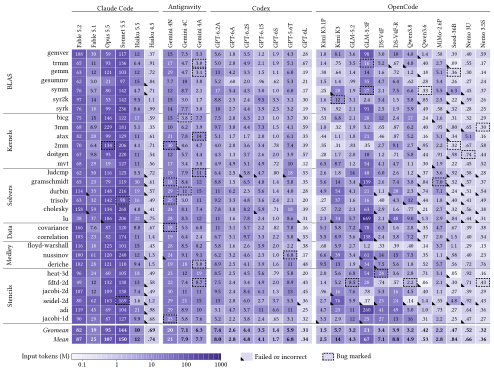
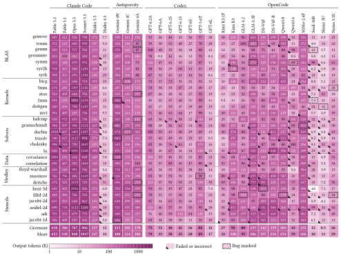
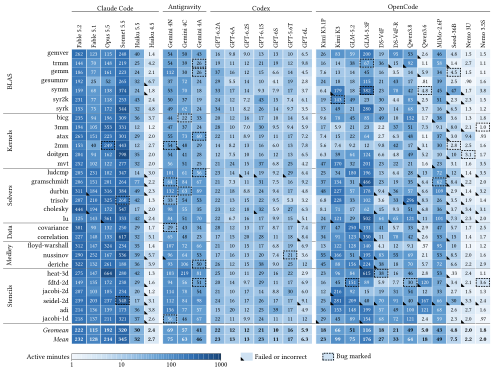
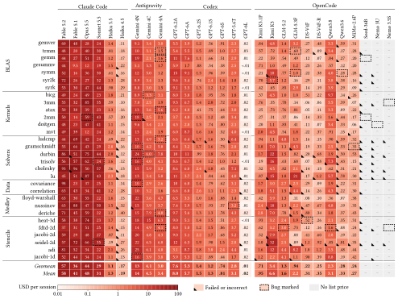
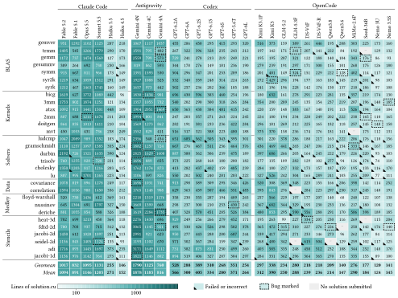

# Cost, Tokens, and Time per Session

The paper's Table 1 reports each model's mean tokens, active time, and cost over its 30 sessions. On this page, we show them for every session, together with the length of the code each session produced. Across all 840 sessions, the models read 16.8 billion input tokens and wrote 180 million output tokens over 909 active hours, which cost 7,124 USD at list price.

## How We Measure

- **Tokens:** we count tokens from each session's own record. Input tokens are fresh input plus cache reads (input the provider serves from its prompt cache) and cache writes (input stored into that cache); output tokens include reasoning.
- **Time:** active time $T_{e2e}$ is the session's wall-clock time without idle gaps.
- **Cost:** we price every token at the vendor's list price as of November 2026. This is not a bill: the closed models ran on subscriptions and the open-weight models on RiVault. Seed-OSS-36B, Nemotron 3 Ultra, and Nemotron 3.5 Super have no published price and are left unpriced.
- **All sessions count:** a session that fails still spent its tokens and time.

The [Inspection Framework](framework.md#cost) page defines these metrics. In every heatmap below, a black corner marks a session that failed or returned incorrect results (in the Verifier or the Bug Verifier), and a dashed frame marks a passed session with a bug marked, as in the paper's Figure 2: 25 solutions with a reproduced bug outside our evaluation setting, kept and scored, and five Gemini sessions that hung on their own test program and were continued. The two footer rows give each model's geometric and arithmetic mean over its 30 sessions; the arithmetic mean equals Table 1 of the paper.

## Tokens

<figure class="njs-fig njs-wide" markdown="span">
  
  <figcaption><strong>Figure 1.</strong> Input tokens per session, cache reads and writes included (millions, log color scale), by kernel and model. Click the figure or select <em>Expand figure</em> for full-screen vector zoom.</figcaption>
</figure>

<figure class="njs-fig njs-wide" markdown="span">
  
  <figcaption><strong>Figure 2.</strong> Output tokens per session, reasoning included (thousands, log color scale), by kernel and model.</figcaption>
</figure>

**Results:** Cache reads make up 98% of all input tokens, because an agent resends its growing context on every step and the provider serves most of it from cache. The ratio of input to output therefore follows how long a session runs rather than how much the model writes: GLM-5.3-Flash reads 235 input tokens per output token, and its 502-minute session on `lu` reads 669 million, while MiMo-V2.6-Pro reads 10.

## Time

<figure class="njs-fig njs-wide" markdown="span">
  
  <figcaption><strong>Figure 3.</strong> Active time \(T_{e2e}\) per session (minutes, log color scale), by kernel and model.</figcaption>
</figure>

**Results:** Sonnet 5.5 runs longest, with a mean of 345 minutes and the single longest session (798 minutes on `doitgen`). Thirty-one sessions run for more than five hours, all from Sonnet 5.5, Opus 5.5, Fable 5.2, and GLM-5.3-Flash.

## Cost

<figure class="njs-fig njs-wide" markdown="span">
  
  <figcaption><strong>Figure 4.</strong> List-price cost per session (USD, log color scale), by kernel and model.</figcaption>
</figure>

**Results:** Model choice, not the kernel, sets the cost. The four large Claude models account for 75% of the total, and none of their 120 sessions costs less than 9 USD. Within one of these models, the most expensive kernel costs 3× (Fable 5.2, Sonnet 5.5) to 10× (Fable 5.1) as much as the cheapest, while across models the same kernel spans more than three orders of magnitude. Time and cost do not rank models the same way: Sonnet 5.5 runs longest yet costs less per session than Fable 5.2 and Opus 5.5, and GLM-5.3-Flash averages 176 minutes but 2.2 USD. Failed sessions cost 389 USD in total, 5.5% of the priced cost.

The decoding speed $D$ in Table 1 of the paper, and how we estimate it from the traces, are on the [Session Behavior](posts/04-session-behavior.md#decoding-speed) page.

## Code Length

<figure class="njs-fig njs-wide" markdown="span">
  
  <figcaption><strong>Figure 5.</strong> Lines of the frozen <code>solution.cu</code> per session (log color scale), by kernel and model. Grey cells are the seven sessions that submitted no solution.</figcaption>
</figure>

**Results:** Stronger models write much longer code. Gemini 4 Neon writes 1,878 lines per solution on average, up to 3,171 lines on `adi`, and the four large Claude models write 890 to 1,210, while Nemotron 3 Ultra, Nemotron 3.5 Super, Qwen3.6-35B-A3B, and Haiku 4.5 write fewer than 160. Across the 28 models, the mean solution length ranks the models almost as their attainment geomean does (Spearman correlation 0.87). Longer solutions hold more specialized paths, such as size-dependent kernels, fallbacks, and the precomputed transforms of algorithm changes, which is also why understanding them takes more effort ([Solution Code](code/index.md)).

All per-session values behind these figures are in `data/cost.csv`.
