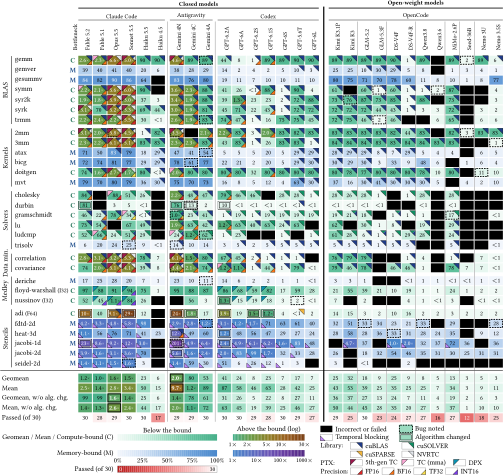

---
hide:
  - navigation
  - toc
---

# Not Just Speedup

Coding agents are now applied to GPU performance engineering. Existing evaluations mostly report end-to-end speedups under fixed turn, time, or cost budgets. However, a single speedup number does not explain why an agent succeeds or fails on a kernel.

In this site, we publish extended analyses, bug verifications, methodology audits, and ongoing model evaluations from our study of coding agents on GPU high-performance computing (HPC) kernels. Specifically, we examine:

- How do agents exceed a reference roofline bound, and why do some narrow-precision or temporal-blocking solutions still fall short?
- When do agents change the algorithm legitimately, and when do they reward-hack the test inputs?
- Which models are strongest at hardware optimization, and which at changing the algorithm?
- How do agents spend their sessions, and do they stop for good reasons?
- How do agents behave with profiler access or without a working GPU?
- What bugs remain in solutions that already pass deterministic verification, and which models produce them?
- How reliable is LLM-assisted trace analysis?

  

    
28

    
Models across 4 harnesses

  

  

    
840

    
B300 sessions over 909 active hours

  

  

    
56 / 77

    
Post-verifier bug claims reproduced on B300

  

  

    
19

    
Verified algorithm changes across 30 kernels

  

## Evaluation Overview

In our evaluation, 28 models across Claude Code, Antigravity, Codex, and OpenCode port 30 PolyBench/C 4.2.1 kernels from serial C to CUDA on dedicated NVIDIA B300 SXM6 GPUs compiled for `sm_103`. Open-weight models run through OpenCode on RiVault, a shared inference service. Agents run without a time limit or mid-run hints against hidden verification and scoring inputs.

Instead of raw speedup, we report roofline attainment: the ratio of the reference algorithm's researcher-validated roofline bound time to the measured runtime. We verify floating-point outputs against a higher-precision reference and integer outputs exactly, and we then run an Analyzer and an isolated Bug Verifier to inspect passing code on untested allowed inputs.

<figure class="njs-fig njs-wide" markdown="span">
  
  <figcaption><strong>Figure 1.</strong> Roofline attainment across 28 models and 30 PolyBench kernels on NVIDIA B300 GPUs. Values show percent below the bound and multiples above it. Solutions exceed the bound through reduced precision or 16-bit DPX (66 solutions), temporal blocking (37 solutions), or algorithm changes (15 of 19 above the bound). Failed cells include 28 Bug Verifier failures. Click the figure or select <em>Expand figure</em> for full-screen vector zoom.</figcaption>
</figure>

## Observations

These are the ten observations of our paper. Each links to the page that gives its full evidence.

1. **Frontier models use reduced-precision and reduced-range units unprompted while preserving required accuracy.** Tasks fix the working format, such as FP32, and permit any arithmetic. Still, 66 passing solutions from ten closed models exceed the compute bound through tensor-core emulation, hand-written operand splitting, or 16-bit DPX, and all pass the Verifier. [Analysis 1 →](posts/01-breaking-the-roofline.md#breaking-the-compute-bound-lower-precision-tensor-cores-for-fp32-and-16-bit-dpx-for-int32)
2. **Some frontier models work around our build setup to use 5th-generation tensor cores.** In all 26 of their `tcgen05.mma` solutions, Opus 5.5, Sonnet 5.5, Fable 5.2, and Gemini 4 Neon compile kernels at run time with NVRTC for the architecture-specific target our build does not use. [Analysis 1 →](posts/01-breaking-the-roofline.md#breaking-the-compute-bound-lower-precision-tensor-cores-for-fp32-and-16-bit-dpx-for-int32)
3. **More models try temporal blocking than reduced precision or reduced range.** 19 of 28 models apply temporal blocking in at least one passed solution, against ten that exceed a compute bound with narrower formats; 18 temporal-blocking solutions still stay below the bound. [Analysis 1 →](posts/01-breaking-the-roofline.md#breaking-the-memory-bound-temporal-blocking)
4. **Stencil optimization is no longer a challenge for frontier models.** On every one of the six iterative stencils, at least three models exceed the bound, including the 3-D `heat-3d`. [Analysis 1 →](posts/01-breaking-the-roofline.md#breaking-the-memory-bound-temporal-blocking)
5. **The flagship models change the algorithm most, and algorithm-level optimization may be less hard than expected.** Gemini 4 Neon and GPT-6.2 Astra change the algorithm on five kernels each and Fable 5.2 on three; no open-weight model does. Each change rests on mathematics such as diagonalization or Toeplitz structure. [Analysis 2 →](posts/02-algorithms-vs-hacking.md)
6. **Gemini 4 Neon may be stronger at algorithm optimization, while Opus 5.5 may be stronger at kernel optimization.** Neon leads on all 30 kernels at 198% of the bound; on the 24 kernels without algorithm changes, Opus 5.5 leads at 161%, ahead of Sonnet 5.5 and Neon. [Analysis 3 →](posts/03-ranking-and-wrap-up.md)
7. **The AI performance model aligns with our understanding for most kernels.** Of the 24 kernels without time steps, the review keeps the AI model on 21 and changes the other three by at most 5.5%. On the six time-step kernels, where the AI model counted stencil traffic only once per run, the bound changes by a factor of 1.7 to 26. [Roofline Model →](roofline.md#what-the-review-changed)
8. **High attainment, quantitative reasoning, and a hypothesis loop appear together.** Long sessions are not required: Gemini 4 Neon reaches the highest geomean in 38 active hours, against 64 to 172 hours for the large Claude models. [Analysis 4 →](posts/04-session-behavior.md)
9. **The agents we test gain little from today's profilers and can work without a GPU, though they need one for performance.** With a profiler, kernels become faster about as often as slower; without a GPU, 23 of 27 sessions still pass, but none exceeds the bound. [Analysis 5 →](posts/05-profilers-and-no-gpu.md)
10. **In performance optimization, access to a flagship model is a competitive advantage.** On `heat-3d`, Fable 5.2 is 2.5× as fast as the hand-tuned EBISU and 1.9× to 7.1× as fast as AN5D, Bricks, DRStencil, and Devito, while every other company's fastest time-stepping solution is at most on par with AN5D. [Stencil Comparison →](stencil.md)

## Analysis

| Section | Topic | Summary |
| :--- | :--- | :--- |
| **1** | [Breaking the Roofline Bound](posts/01-breaking-the-roofline.md) | Per-model precision and temporal-blocking tables, 32 below-bound narrower-format solutions, and the attainment overview. |
| **2** | [Algorithm Changes and Reward Hacking](posts/02-algorithms-vs-hacking.md) | 19 verified algorithm changes, the ADI spectral derivation, 13 false positives, and reward hacking. |
| **3** | [Ranking and Wrap-Up](posts/03-ranking-and-wrap-up.md) | Model rankings for hardware optimization alone and with algorithm changes. |
| **4** | [Session Behavior](posts/04-session-behavior.md) | Step activities, time split, parameter search, and Analyzer labels per model; 6 of 840 justified stops. |
| **5** | [Profiler and No-GPU Ablations](posts/05-profilers-and-no-gpu.md) | 185 paired Nsight sessions ($\rho = -0.06$) and 30 sessions from a faulty-GPU incident. |
| **6** | [Bug Analysis](posts/06-silent-gpu-bugs.md) | All 102 failures by where they were caught, and how agents handle bugs during a session. |
| **7** | [Bugs Beyond the Verifier](posts/07-bugs-beyond-the-verifier.md) | Bugs the Analyzer finds in solutions the Verifier passed: 77 claims, 56 reproduced, failure rates by model, root causes, and six CUDA cases. |
| **8** | [Analyzer Cross-Check: Claude against Codex](posts/08-analyzer-reliability.md) | Claude against Codex agreement on 180 traces over 17 rubric fields. |

Per-session tokens, active time, and list-price cost are on the [Cost](cost.md) page, agent `heat-3d` solutions against hand-built stencil libraries on the [Stencil Comparison](stencil.md) page, the framework and metrics behind every number on the [Evaluation Framework](framework.md) page, and the code of the fastest solutions on the [Solution Code](code/index.md) page.

