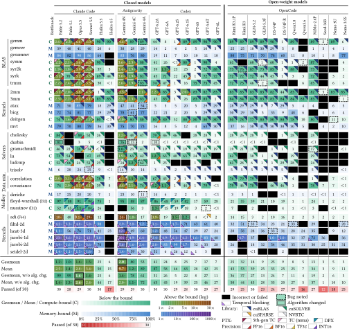

# Breaking the Roofline Bound

Across our 28-model study, 103 passed solutions keep the reference algorithm intact yet exceed its roofline bound: 66 move compute-bound arithmetic onto narrower specialized hardware units, and 37 reduce memory traffic on iterative stencils through temporal blocking. In this section, we report the per-model precision and temporal-blocking tables omitted from the paper, examine why 32 narrower-format solutions stay below the bound.

## Attainment Overview

<figure class="njs-fig njs-wide" markdown="span">
  
  <figcaption><strong>Figure 1.</strong> Roofline attainment across 28 models and 30 PolyBench kernels on NVIDIA B300 GPUs, the paper's Figure 2. Values show percent below the bound and multiples above it. Click the figure or select <em>Expand figure</em> for full-screen vector zoom.</figcaption>
</figure>

## Breaking the Compute Bound: Lower-Precision Tensor Cores for FP32 and 16-bit DPX for INT32

The reference performance model assumes CUDA-core execution in each kernel's nominal format: FP32 at 75 TFLOP/s, FP64 at 1.2 TFLOP/s for `adi`, and INT32 at 37.5 Top/s for `floyd-warshall` and `nussinov`. On NVIDIA B300 GPUs, tensor cores provide 15× to 30× higher throughput in TF32, FP16, or BF16, and 2-way packed 16-bit DPX instructions double integer add-min/max throughput.

Table 1 lists every model that uses reduced precision or 16-bit DPX in a passed compute-bound solution without an algorithm change.

| Model | Above bound | cuBLAS (by format) | Hand-written (by format) | Flagged not general | Below bound |
| :--- | :---: | :--- | :--- | :---: | :---: |
| Fable 5.2 | 8 | 5 (BF16 3, FP16 2) | 3 (FP16 3) | 2 | 1 |
| Fable 5.1 | 9 | 8 (BF16 7, FP16 1) | 1 (BF16 1) | — | 4 |
| Opus 5.5 | 11 | — | 11 (FP16 8, BF16 3, INT16 1) | 8 | 2 |
| Sonnet 5.5 | 10 | — | 10 (FP16 9, TF32 1) | 8 | 4 |
| Gemini 4 Neon | 13 | 8 (BF16 7, FP16 3, TF32 1) | 5 (BF16 4, FP16 2) | 3 | 1 |
| Gemini 4 Carbon | 8 | 8 (BF16 8) | — | — | 2 |
| Gemini 4 Argon | 1 | 1 (BF16 1) | — | — | 2 |
| GPT-6.2 Astra | 3 | 2 (BF16 2) | 1 (FP16 1) | — | 4 |
| GPT-6 Astra | 2 | 2 (BF16 2) | — | — | 4 |
| GPT-6.2 Sol | — | — | — | — | 3 |
| GPT-6.1 Sol | 1 | 1 (BF16 1) | — | — | 5 |
| **Total** | **66** | **35** (BF16 31, FP16 6, TF32 1) | **31** (FP16 23, BF16 8, TF32 1, INT16 1) | **21** | **32** |

*Table 1. Passed compute-bound solutions using narrower formats, algorithm changes excluded. Above and below bound count solutions; a solution can use more than one format across phases, so the formats in a cell can sum above its count. BF16 includes cuBLAS BF16x9 emulation. Flagged not general counts above-bound solutions that the Analyzer (G10) flags as relying on a task condition, such as operand splits at a fixed scale that hold only for our `[-1, 1]` input domain. No open-weight model exceeds a compute bound.*

**Runtime NVRTC for 5th-generation tensor cores:** Our benchmark compiles for the generic target `sm_103`, while `tcgen05.mma` instructions require an architecture-specific target such as `sm_103a`. In all 26 of their passing `tcgen05.mma` solutions, Opus 5.5, Sonnet 5.5, Fable 5.2, and Gemini 4 Neon compile kernels at run time with NVRTC and pass `--gpu-architecture=sm_103a` themselves. In contrast, the eight solutions using `mma.sync` compile directly without NVRTC.

**Below-bound narrower-format solutions:** Using a narrower format does not guarantee exceeding the bound. Thirty-two other passed solutions use one yet reach only 0.5% to 94% of the bound. Of these 32, 24 call BF16x9 emulation in cuBLAS or cuSOLVER, five use FP16, BF16, or TF32 directly, and three use 16-bit DPX: Sonnet 5.5 on both integer kernels and Fable 5.1 on `nussinov`. By kernel, 12 of the 32 are factorizations on `cholesky`, `gramschmidt`, `lu`, or `ludcmp`, while GPT-6.2 Sol calls cuBLAS emulation on `gemm`, `symm`, and `correlation` and still stays below 2%.

## Breaking the Memory Bound: Temporal Blocking

More models try temporal blocking than narrower formats: 19 of 28 models apply temporal blocking in at least one passed solution, including four open-weight models, while ten closed models exceed a compute bound with narrower formats. Table 2 separates above-bound and below-bound temporal-blocking solutions.

| Model | Above | Below |
| :--- | :---: | :---: |
| Fable 5.2 | 4 | — |
| Fable 5.1 | 4 | — |
| Opus 5.5 | 4 | 1 |
| Sonnet 5.5 | 4 | — |
| Haiku 5.5 | 1 | 3 |
| Gemini 4 Neon | 2 | — |
| Gemini 4 Carbon | 3 | 2 |
| Gemini 4 Argon | 3 | 1 |
| GPT-6.2 Astra | 2 | 1 |
| GPT-6 Astra | 2 | 1 |
| GPT-6.2 Sol | 2 | 2 |
| GPT-6.1 Sol | 2 | 2 |
| GPT-6 Sol | 1 | 1 |
| GPT-5.6 Terra | — | 2 |
| GPT-6 Luna | — | 1 |
| *Kimi K3* | 1 | — |
| *DeepSeek-V4-Flash* | 1 | — |
| *DeepSeek-V4-Flash-R* | 1 | — |
| *MiMo-V2.6-Pro* | — | 1 |
| **Total** (closed / open-weight) | **37** (34 / 3) | **18** (17 / 1) |

*Table 2. Passed memory-bound stencil solutions that apply temporal blocking, algorithm changes excluded. Open-weight models in italics.*

Across the 55 temporal-blocking solutions in Table 2, 37 exceed the bound (34 closed and 3 open-weight) and 18 stay below it, including 3 of 4 on `heat-3d`.
