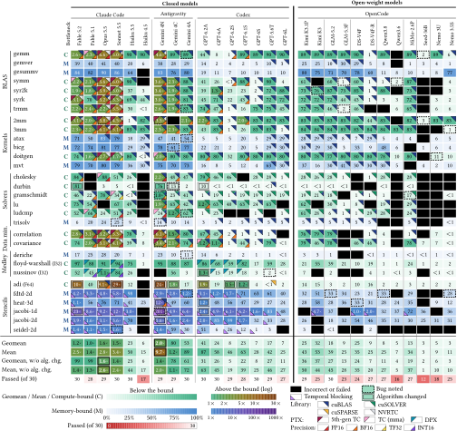

# Algorithm Changes and Reward Hacking

When an agent exceeds the roofline bound by 10× to 200×, the speedup can come from either a valid algorithm change or a shortcut tailored to test inputs. Both rely on inspecting the specification to remove work. In this section, we list all 19 verified algorithm changes, explain each technique, and document the two reward-hacking incidents caught during earlier benchmark rounds.

## Attainment Overview

<figure class="njs-fig njs-wide" markdown="span">
  
  <figcaption><strong>Figure 1.</strong> Roofline attainment across 28 models and 30 PolyBench kernels on NVIDIA B300 GPUs, the paper's Figure 2. A double frame marks a solution that changes the algorithm. Click the figure or select <em>Expand figure</em> for full-screen vector zoom.</figcaption>
</figure>

The 19 algorithm changes affect six kernels:

| Kernel | Algorithm in the reference code | Changed solutions | Above the bound | Fastest solution (code) |
| :--- | :--- | :---: | :---: | :--- |
| `adi` | Alternating-direction implicit (Peaceman–Rachford) time stepping | 8 | 8 | [Sonnet 5.5](../code/adi-sonnet-5-5.md) |
| `durbin` | Levinson–Durbin recursion for a Toeplitz system | 4 | 0 | [Fable 5.2](../code/durbin-fable-5-2.md) |
| `jacobi-1d` | Explicit 3-point stencil time stepping | 3 | 3 | [Gemini 4 Neon](../code/jacobi-1d-gemini-4-neon.md) |
| `heat-3d` | Explicit 7-point stencil time stepping | 2 | 2 | [Gemini 4 Neon](../code/heat-3d-gemini-4-neon.md) |
| `jacobi-2d` | Explicit 5-point stencil time stepping | 1 | 1 | [Gemini 4 Neon](../code/jacobi-2d-gemini-4-neon.md) |
| `nussinov` | Interval dynamic programming for RNA folding | 1 | 1 | [GPT-6.2 Astra](../code/nussinov-gpt-6-2-astra.md) |
| **Total** | | **19** | **15** | |

*Table 1. Kernels where passed solutions change the algorithm on tested inputs.*

## Auditing 38 Analyzer Candidates

String matching on the Analyzer's algorithmic-change field (G10) returned 38 passed candidates. We checked every candidate by reading its frozen `NOTES.md`, `solution.cu`, and dispatch conditions against the Verifier's instances, and we verified every published reference by DOI:

- **13 false positives:** e.g., recognizing a loop nest as a BLAS `SYMM` or `TRMM` call, unrolling base cases in `nussinov` while keeping $O(n^3)$ work, or index decoding of a wavefront schedule in `seidel-2d`.
- **4 reorganizations of the same algorithm:** e.g., closed-form Thomas pivots in `adi` that still execute all $2n_0$ sweeps, and block-parallel affine scans in `deriche`.
- **3 unreachable changed paths:** e.g., DeepSeek-V4-Flash-R implemented binary matrix exponentiation for `seidel-2d` only on grids at most $8 \times 8$ with $n_0 > 300$, which neither the correctness instances nor the $211 \times 16381$ scored instance reaches.
- **19 genuine algorithm changes:** the remaining 18 G10 candidates plus one `nussinov` solution found by manual inspection (`GPT-6.2 Astra`). Fifteen of these 19 exceed the roofline bound.

The last column of Table 1 links the code of the fastest solution per kernel, next to the reference kernel it started from. Table 2 lists all 19 verified algorithm changes, the published work that proposed each optimization, and similar work where we found none.

| Technique | Kernel | Solutions (attainment) | Prior work | Similar work |
| :--- | :--- | :--- | :--- | :--- |
| All $2n_0$ sweeps as one precomputed multi-step kernel, applied by FFT | `jacobi-1d` | Gemini 4 Neon (201×), GPT-6.2 Astra (2.4×) | Ahmad et al. (SPAA '21, TOPC '23) | |
| All $2n_0$ sweeps as one precomputed multi-step kernel, applied by two-stage direct convolution | `jacobi-1d` | Fable 5.2 (23×) | Chen et al. (PPoPP '24) fuse time steps into one precomputed kernel and apply it directly; Fable fuses all steps, truncated and evaluated in two stages | Ahmad et al. (SPAA '21, TOPC '23) apply the all-step kernel by FFT |
| All $n_0$ implicit ADI steps collapsed into one power per DST-I mode | `adi` | Sonnet 5.5 (29×), Gemini 4 Neon (24×), Fable 5.2 (10×), Opus 5.5 (9.1×), GPT-6.2 Astra (3.9×), Gemini 4 Carbon (1.8×), GPT-6.2 Sol (1.5×), GPT-6.1 Sol (1.2×) | None found | Ahmad et al. (SPAA '21, TOPC '23) for explicit stencils; Hockney (1965) and Buzbee et al. (1970) diagonalize one elliptic solve with fast transforms |
| All steps of an explicit stencil collapsed into one power per DST-I mode | `heat-3d`, `jacobi-2d` | Gemini 4 Neon (`heat-3d` 12×, `jacobi-2d` 5.6×), GPT-6.2 Astra (`heat-3d` 1.2×) | Ahmad et al. (SPAA '21, TOPC '23) | |
| Dominated splits of the interval recurrence dropped (exact) | `nussinov` | GPT-6.2 Astra (1.3×) | Wexler et al. (JCB '07) | |
| Preconditioned CG with FFT Toeplitz products replaces Levinson–Durbin | `durbin` | Fable 5.2 (81%), Gemini 4 Neon (76%), Gemini 4 Carbon (13%), GPT-6.2 Astra (10%) | Strang (1986); Chan and Ng (1996); Ng et al. (2003) | |

*Table 2. Passed solutions that change the algorithm on tested inputs. Prior work proposed this optimization for this kind of computation; similar work uses a related idea on a different problem, so the agents' change is new for this kernel as far as we found. Attainment is against the reference algorithm's bound and serves only to compare runtimes; a new algorithm would need its own roofline model.*

Flagship models account for most changes: Gemini 4 Neon and GPT-6.2 Astra change the algorithm on five kernels each and Fable 5.2 on three, compared with at most two for other closed models and zero for all open-weight models.

## Spectral Closed Form for Implicit `adi`

`adi` is an implicit 2-D stencil: each time step solves tridiagonal linear systems along $x$ and $y$, so work in the reference Peaceman–Rachford scheme grows linearly with the step count $n_0$. Eight solutions across Anthropic, Google, and OpenAI replace all $n_0$ steps with one transform whose cost does not depend on $n_0$.

Their derivation has three steps.

**Step 1: make each step linear.** The boundary is held at 1, so $W = U - 1$ is zero on the boundary and each step is linear in $W$. With $K$ the second-difference matrix along $x$ or $y$, and $\mu_x = 2\Delta t/\Delta x^2$ and $\mu_y = \Delta t/\Delta y^2$ the coefficients of the two directions, one Peaceman–Rachford step is

$$
W^{t+1} = \bigl(I + \tfrac{\mu_y}{2}K_y\bigr)^{-1}\bigl(I - \tfrac{\mu_x}{2}K_x\bigr)\bigl(I + \tfrac{\mu_x}{2}K_x\bigr)^{-1}\bigl(I - \tfrac{\mu_y}{2}K_y\bigr)\,W^{t}.
$$

**Step 2: diagonalize.** Every factor is a function of $K$, and the discrete sine transform (DST-I) $S$ diagonalizes $K$ with eigenvalues $\lambda_j$. In the sine basis $\hat W = S\,W\,S$, a step only scales each mode $(j, k)$, by $g_x(\lambda_j)\,g_y(\lambda_k)$ with

$$
g_d(\lambda) = \frac{1 - \mu_d\lambda/2}{1 + \mu_d\lambda/2}.
$$

**Step 3: take the power.** All remaining steps scale each mode by the power of this factor:

$$
\hat W^{n_0}_{jk} = \bigl(g_x(\lambda_j)\,g_y(\lambda_k)\bigr)^{n_0-1}\,\hat W^{1}_{jk}.
$$

The power starts from $W^1$, which comes from one ordinary step, because the first step also reads the boundary columns of the input, which need not be 1. The transform is valid because the coefficients and the boundary value are constant: a property of the kernel, not of its inputs. The cost is two sine transforms and one power per mode, independent of $n_0$.

The eight solutions differ in how they compute $S$: Opus 5.5 computes dense products on tensor cores using Ozaki-style splits, while the others use FFTs, including Bluestein's algorithm for general grid sizes. While this idea is known for explicit linear stencils, we found no prior paper applying it to ADI or another implicit scheme where $g_d$ is a rational function rather than a polynomial.

**Code:** the fastest solution, [Sonnet 5.5 (29×)](../code/adi-sonnet-5-5.md), with the reference kernel and the Analyzer's legitimacy review.

## `jacobi-1d`: All Time Steps as One Convolution

The reference code runs $K = 2n_0$ half-steps of a 3-point average, $u_i \leftarrow c\,(u_{i-1} + u_i + u_{i+1})$ with $c = 0.33333$, alternating between two arrays whose end cells stay fixed. The scored instance has $n_0 = 331$ and $n_1 = 134{,}217{,}689$ cells, so stepping costs $2n_0 n_1 \approx 8.9 \times 10^{10}$ cell updates.

All three solutions start from the same observation. The update is linear with constant coefficients, so the boundary contribution can be split off (a steady-state profile or a precomputed boundary response), and the interior after $s$ half-steps is the initial array convolved with one $s$-step kernel $w_s$: $c^s$ times the trinomial coefficients, applied to the odd-periodic extension of the array so that the fixed ends are respected. The kernel decays like a Gaussian of width about $\sqrt{s}$, so it can be truncated at a few multiples of $\sqrt{s}$ with an error far below FP32 resolution. The work per cell then no longer grows with $s$. The three solutions differ in how they apply the kernel, and this is the part that decides speed.

- **Gemini 4 Neon (201×): FFT.** It applies the truncated kernel by overlap-save convolution with its own FP32 FFT in shared memory (block lengths 1,024 to 32,768; no cuFFT), truncating at $6\sqrt{s}$ with a tail below $4 \times 10^{-12}$. A 9-tap pre-filter with zeros at the Nyquist frequency and at $2\pi/3$, where the Jacobi symbol $c(1 + 2\cos\theta)$ vanishes, keeps FP32 FFT rounding at those frequencies from leaking into the result. The boundary responses depend only on the shape and are computed once in `pb_setup` with an FP64 FFT on the host. Runs with $n_0 \le 14$ use register-level temporal blocking instead.
- **GPT-6.2 Astra (2.4×): FFT in FP64.** At the scored size it also applies the kernel by overlap-save convolution, with its own radix-2 FFT of at most 2,048 points, in FP64. The kernel comes from the trinomial recurrence folded over the odd reflection, and two tridiagonal solves give the boundary terms. On moderate grids the same convolution runs as FP64 tensor-core products (`mma.sync` m8n8k4 f64), and for very long runs on short arrays it projects onto the few sine modes that survive.
- **Fable 5.2 (23×): direct convolution, no FFT.** It factors the kernel into two stages, $w_s = w_{K_2} * w_{K_1}$: it evaluates the state after $K_1$ half-steps only at every $D$-th cell, $D \approx 0.36\sqrt{s}$, and interpolates the rest with $w_{K_2}$. This costs about 47 kernel taps per cell for any $n_0$. It computes in double-float (pairs of FP32 with error-free sums) in the interior and FP64 near the ends, and bounds truncation and aliasing at $10^{-11}$. For short runs ($n_0$ below 100 to 128, depending on the array length) or arrays under 1,024 cells, it falls back to temporal blocking that matches the reference bit for bit.

The difference matters for both speed and novelty. An FFT costs $O(\log L)$ per cell for block length $L$, while a direct convolution costs one multiply-add per kernel tap; Fable's decimation is what keeps its tap count at 47 instead of thousands. Astra's FFT runs in FP64, which the B300 executes at a small fraction of its FP32 rate, consistent with its much lower attainment. Both halves of the idea have prior work. Precomputing a multi-step kernel and applying it directly is the temporal kernel fusion of ConvStencil (Chen et al., PPoPP '24), which merges a few time steps into one larger stencil, e.g., two fusions turn a 9-point 2-D stencil into a 49-point one. Fable 5.2 follows this route but fuses all $2n_0$ steps, which is affordable only because it truncates the kernel and evaluates it in two decimated stages. Applying the all-step kernel through the Fourier domain is the method of Ahmad et al. (SPAA '21, TOPC '23), which Neon and Astra follow.

**Code:** the fastest solution, [Gemini 4 Neon (201×)](../code/jacobi-1d-gemini-4-neon.md), with the reference kernel and the Analyzer's legitimacy review.

## Explicit Stencils: `heat-3d` and `jacobi-2d`

Gemini 4 Neon applies the `adi` idea to two explicit stencils: on `jacobi-2d` (5.6×) and `heat-3d` (12×), the sine transform diagonalizes the update, so all time steps become one power per mode. GPT-6.2 Astra does the same on `heat-3d` (1.2×). For an explicit stencil, the per-mode factor is a polynomial in the eigenvalue rather than the rational function of `adi`, which is the case Ahmad et al. treat. On `heat-3d`, Neon computes the sine transform as BF16 matrix products on tensor cores with the Ozaki scheme, which splits each FP32 operand into several BF16 parts to recover FP32 accuracy.

**Code:** the fastest solutions, Gemini 4 Neon on [`heat-3d` (12×)](../code/heat-3d-gemini-4-neon.md) and [`jacobi-2d` (5.6×)](../code/jacobi-2d-gemini-4-neon.md), with the reference kernels and the Analyzer's legitimacy reviews.

## `durbin`: An Iterative Instead of a Direct Solver

The reference code solves a Toeplitz system with the Levinson–Durbin recursion: $n$ dependent steps of $O(n)$ work each, so the work is $O(n^2)$ and inherently sequential. Fable 5.2, Gemini 4 Neon, Gemini 4 Carbon, and GPT-6.2 Astra replace it with preconditioned conjugate gradients (CG). This is valid because the Toeplitz matrix is symmetric positive definite, so CG converges to the same solution. Each product with the matrix costs $O(n \log n)$ by embedding it in a circulant matrix and applying the FFT (Strang 1986; Chan and Ng 1996), and a preconditioner keeps the iterations few; Fable builds its preconditioner from the first 253 recursion steps (Ng et al. 2003). All four stay below the bound, at 10% to 81%.

**Code:** the fastest solution, [Fable 5.2 (81%)](../code/durbin-fable-5-2.md), with the reference kernel and the Analyzer's legitimacy review.

## `nussinov`: Fewer Split Points

`nussinov` fills an interval dynamic-programming table for RNA folding: each cell takes the best of all split points of its interval, which costs $O(n^3)$ in total. GPT-6.2 Astra reaches 126% of the INT32 bound without a narrower format by keeping, per column, only the split points that no other split can reproduce. This sparsification is known for RNA folding (Wexler et al., JCB '07). The result stays exact, but the work now depends on the input: dense inputs still need cubic work.

**Code:** the only solution, [GPT-6.2 Astra (1.3×)](../code/nussinov-gpt-6-2-astra.md), with the reference kernel and the Analyzer's legitimacy review.

## Algorithm-Level Reward Hacking

In an earlier benchmark round, inspecting every solution above the roofline bound caught two kernels where solutions gained their speed from a property of our test inputs rather than of the kernel. We judged both cases by hand, reading the Verifier results and the frozen source code; the round predates the Analyzer's legitimacy goals, so neither case has an Analyzer report.

- **`floyd-warshall`:** Uniform edge weights in $[0, 256]$ gave each node roughly 25 zero-weight edges that connected the whole graph, so every shortest distance was 0. Four models exploited this, reaching 24× to 78× above the bound. Sonnet 5.5, Opus 5.5, and GPT-6 Astra contract the zero-weight strongly connected component and solve the much smaller remaining graph; GPT-6.1 Sol proves zero-weight reachability between all vertices before filling the output with zeros. All four stay exact on general graphs, but run in $O(n^2)$ instead of $O(n^3)$ only on our degenerate input. Code: [Sonnet 5.5](../code/floyd-warshall-sonnet-5-5-round-011.md).
- **`ludcmp`:** Our initial matrices were strictly diagonally dominant, and the task stated so. Five of the six fastest solutions replaced LU factorization with a Jacobi-type iteration, reaching up to 54× above the bound. On an independently drawn non-dominant matrix, they fell back to LU and ran 36 to 104 times slower, and two of the five returned a wrong solution. Code: [Opus 5.5](../code/ludcmp-opus-5-5-round-011.md).

We recorded both incidents as reward hacking and updated our input rule: inputs must resemble real workloads and must not make an input-specific shortcut certain to win. After switching `floyd-warshall` to measured Internet latencies and `ludcmp` to general dense matrices and re-running all agents, no solution of either kernel exceeds the bound, and the Analyzer finds no reward hacking in the reruns.
