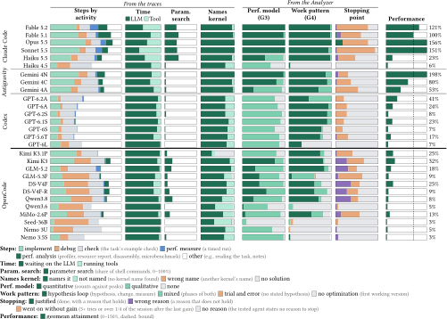

# Session Behavior

In this section, we show how each model's 30 sessions divide their steps and time, measured by deterministic trace preprocessing, together with the Analyzer's performance-engineering labels ([Inspection Framework](../framework.md#analyzer-goals)).

<figure class="njs-fig njs-wide" markdown="span">
  
  <figcaption><strong>Figure 1.</strong> Session activity, time split, parameter-search share, kernel identification, and Analyzer labels across the 28 models, ordered by attainment rank. Click the figure or select <em>Expand figure</em> for full-screen vector zoom.</figcaption>
</figure>

**Results:** The strongest models, the four large Claude models and Gemini 4 Neon, are also the ones that model performance quantitatively and use a hypothesis loop. Whether this behavior causes high performance or only comes with a stronger model is future work. Long runs alone do not produce high attainment: GLM-5.3-Flash runs for 88 active hours and reaches 9% geomean, while Gemini 4 Neon reaches 198% in 38 hours. Note that almost no session stops cleanly: only 6 of 840 stops are justified, five by Opus 5.5.

## Decoding Speed

How fast a model generates tokens sets how long its sessions take. We do not measure this speed with a benchmark program: we estimate it after the fact from the agents' own traces. Every model request in a trace records its duration and its token counts, and we fit, over all requests of a model, wall-clock duration $t$ as a linear function of uncached input tokens $I$, cache-read tokens $R$, and output tokens $O$, reasoning included:

$$
t \approx a + \frac{I}{P} + \frac{R}{C} + \frac{O}{D}, \qquad a, P, C, D > 0.
$$

The fit is a non-negative robust regression with Huber loss on relative residuals, and its spread comes from a bootstrap over sessions. No model was called and no program was run for it, so $D$ is the decoding speed each agent actually experienced under the provider's load during our sessions, not an advertised peak. The fixed latency $a$ collects network round trips, queueing, and the part of the time to first token that does not grow with the request. The plain output rate, output tokens over request duration, needs no fit and is shown for comparison.

--8<-- "includes/decoding-speed-table.md"

*Table 1. Decoding speed per model, estimated from the requests in its 30 sessions. The 90% range is the 5th to 95th percentile over a bootstrap of sessions; fit quality is good when that range is narrow and the fit explains the log durations well, and fair otherwise. The decoding speed of the open-weight models reflects RiVault's serving, not the model alone.*

## Development Setbacks

Besides bugs in its code, which [Analysis 6](06-silent-gpu-bugs.md#how-agents-handle-bugs-during-a-session) summarizes, an agent meets setbacks while developing. The Analyzer (G5) records five kinds: a compile or link error; a tool or session failure, such as an interrupted model stream, a failing script, or a missing library path; a slower version or one with no gain; an invalid measurement of its own, such as a benchmark whose launch silently failed; and a hypothesis or prediction refuted by its own data. Across the 840 sessions it lists 6,921 setbacks, 8.2 per session. Each bar below is one model: its length is the setbacks per session, and its segments show how the agent responded.

**Results:** How agents respond depends on what the setback tells them. They fix 89% of compile errors after a diagnosis and work around a third of tool failures (34%). A slower version is mostly reverted (47%). The two setbacks that require reflection are the ones agents most often miss: they ignore or do not notice 25% of their invalid measurements and 33% of the hypotheses their own data refuted.

## Session Matrices

Every cell is one session: rows are the 30 kernels and columns the 28 models. The matrices below group the views into correctness, performance, and trace statistics; choose a view to colour the cells, and hover a cell for all labels of that session. The correctness and performance views are Analyzer labels, defined on the [Inspection Framework](../framework.md#analyzer-goals) page; the trace statistics come from deterministic preprocessing without an LLM. The per-session values are in `data/analyzer-labels.csv`.

### Correctness

### Performance

### Trace Statistics

