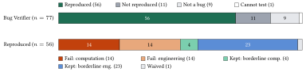
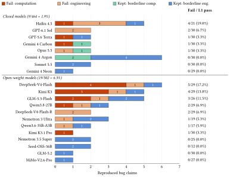
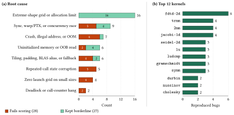

# Bugs Beyond the Verifier

A solution that passes our deterministic Verifier can still be wrong on allowed inputs the Verifier does not test. This section covers exactly these bugs: the Analyzer finds them by reading the trace and the code of solutions that the Verifier has already accepted, and the Bug Verifier confirms them by running the code. They are a large share of all bugs: the Bug Verifier fails 28 solutions that the Verifier passed, against 24 wrong outputs and crashes the Verifier itself catches ([Analysis 6](06-silent-gpu-bugs.md)), and it reproduces another 27 borderline bugs that we keep but mark. We compare failure rates across model classes, classify root causes, and examine six verbatim CUDA defects reproduced on NVIDIA B300 GPUs.

## Method

Across 840 sessions, 766 solutions passed our deterministic Verifier. The Verifier checks five correctness sizes, a speed-gate size, a large-reference size, and the scored size against an FP64 reference for FP32 kernels and bit-exact outputs for integer kernels. For every passing solution, the Analyzer inspects the trace and final source code and flags suspected bugs on allowed inputs that the Verifier's instances do not exercise (G10). Every bug on this page was therefore missed by the Verifier and found by the Analyzer.

Because the Analyzer never runs code, every claim is treated as unverified until our isolated Bug Verifier runs the unmodified binary on a dedicated B300 GPU and produces both a failing allowed input and a nearby passing control. Across 67 passing solutions, the Analyzer raised 77 claims. Figure 1 summarizes the execution verdicts and scoring outcomes.

<figure class="njs-fig njs-wide" markdown="span">
  
  <figcaption><strong>Figure 1.</strong> Bug Verifier outcomes across all 77 bugs the Analyzer claims in solutions the Verifier passed (top), and scoring classification of the 56 reproduced defects (bottom). Every claim targeted a solution that had already passed the deterministic Verifier.</figcaption>
</figure>

Of the 77 claims, the Bug Verifier reproduces 56 (72.7%), cannot reproduce 11 (14.3%), rejects 9 as not a bug (11.7%), and cannot test 1 watchdog trigger. We inspect every reproduced defect and separate computation errors from engineering errors:

- **Computation errors:** the solution returns wrong numerical outputs, often with exit code `0` and no CUDA error. We fail 14 solutions with computation errors under our dedicated-GPU setting.
- **Engineering errors:** the solution fails on an allowed input without returning a wrong answer, such as a crash, illegal address, zero launch grid, hang, allocation error, or timeout. We fail 14 solutions whose engineering errors fail standard checks.
- **Borderline defects (kept and marked):** 27 reproduced bugs across 25 solutions require conditions outside our evaluation setting and are kept but marked. They comprise 16 extreme-dimension grid or allocation limits (one dimension from roughly 70,000 to 1.4 billion), 4 out-of-bounds reads with unaffected outputs shown only by a memory checker, 5 co-resident GPU load hazards (3 computation races, 1 persistent-kernel SM hang, and 1 optional-allocation sticky error), 1 fixed-scale FP16 split accuracy drop on `1e-5` inputs (`Opus 5.5` on `2mm`, which meets FP32 accuracy on the task's `[-1, 1]` domain), and 1 slow-but-correct fallback (`Sonnet 5.5` on `seidel-2d`, still about 280× as fast as single-threaded CPU).

One reproduced claim, `Sonnet 5.5` returning `+0.0` instead of `-0.0` in never-written `fdtd-2d` border cells, was waived.

## Model Reliability

Raw bug counts depend on how many kernels a model passes in the Verifier. Figure 2 reports both reproduced claim counts and the fraction of Verifier-passed solutions disqualified by the Bug Verifier.

<figure class="njs-fig njs-wide" markdown="span">
  
  <figcaption><strong>Figure 2.</strong> Reproduced bugs by model across the 20 models with at least one reproduced claim, ordered within closed and open-weight groups by failing count. Eight models had zero reproduced bugs: Fable 5.2, Fable 5.1, Haiku 5.5, GPT-6.2 Astra, GPT-6 Astra, GPT-6.2 Sol, GPT-6 Sol, and GPT-6 Luna.</figcaption>
</figure>

**Results:** Open-weight models fail Bug Verification at 3.2× the rate of closed models. Table 1 aggregates the 766 Verifier passes across model tiers.

| Model group | Models | Verifier passes | Disqualified (comp. / eng.) | Failing rate |
| :--- | :---: | :---: | :---: | :---: |
| Flagship closed (Fable 5.2, Neon, GPT-6.2 Astra) | 3 | 89 | 0 (0 / 0) | 0.0% |
| Other closed, excluding Haiku 4.5 | 12 | 354 | 5 (2 / 3) | 1.4% |
| Haiku 4.5 | 1 | 21 | 4 (1 / 3) | 19.0% |
| All closed models | 16 | 464 | 9 (3 / 6) | 1.9% |
| All open-weight models | 12 | 302 | 19 (11 / 8) | 6.3% |
| Total | 28 | 766 | 28 (14 / 14) | 3.7% |

Three observations follow from Figure 2 and Table 1:

1. **The three flagship models have zero disqualifying bugs.** Across 89 Verifier-passed solutions from Fable 5.2, Gemini 4 Neon, and GPT-6.2 Astra, no solution fails Bug Verification; Neon carries only one borderline allocation error at 1.4 billion rows by 2 columns.
2. **Hand-written low-level optimization does not imply higher defect rates among top closed models.** Across 119 Verifier passes from Fable 5.2, Opus 5.5, Sonnet 5.5, and Gemini 4 Neon—which write runtime NVRTC `tcgen05.mma` kernels, 16-bit DPX, and spectral transforms—only one fails (`Opus 5.5` on `lu`, deadlocking on call 2,541,396).
3. **Disqualifying defects cluster in specific open-weight models and Haiku 4.5.** DeepSeek-V4-Flash loses 5 of 29 passes (17.2%, including 4 computation errors), Kimi K3 loses 4 of 29 (13.8%, 3 computation errors), GLM-5.3-Flash loses 3 of 26 (11.5%), and Haiku 4.5 loses 4 of 21 (19.0%). In contrast, GLM-5.2 passes all 30 kernels with zero failing bugs, relying mainly on cuBLAS and direct kernels.

## Root Causes and Affected Kernels

Figure 3 groups the 55 counted reproduced bugs by underlying CUDA mechanism and lists the 12 most affected kernels.

<figure class="njs-fig njs-wide" markdown="span">
  
  <figcaption><strong>Figure 3.</strong> (a) Root-cause breakdown of the 55 counted reproduced bugs, split by failing (28) and kept borderline (27). (b) Top 12 PolyBench kernels by reproduced bug count; 24 of 30 kernels have at least one reproduced defect.</figcaption>
</figure>

Borderline bugs are dominated by extreme-dimension CUDA grid limits (16 of 27). Disqualifying bugs concentrate in crashes and allocation errors (6), synchronization, warp, PTX, or inter-block races (5), repeated-call state corruption (5), tiling, padding, or BLAS aliasing bugs (4), and zero launch grids on small sizes (4).

By kernel, defects cluster in iterative stencils (`fdtd-2d`, `seidel-2d`, `jacobi-1d`, `jacobi-2d`) and triangular or matrix factorizations (`trmm`, `2mm`, `lu`, `ludcmp`, `gramschmidt`, `symm`, `cholesky`). Stencils introduce ping-pong buffers and interior bounds (`n1 - 2`), while factorizations mutate triangular views in place and pair library calls with custom panels.

## Verbatim CUDA Case Studies

The six cases below are taken directly from frozen candidate `solution.cu` files and reproduced on B300 GPUs. Each shows why conventional multi-size verification missed the defect.

### 1. L2-Cache-Masked `cp.async` Pipeline (`Kimi K3`, `symm`)

Kimi K3 stages $K$-tiles into double-buffered shared memory using inline PTX `cp.async`:

```cuda
// Kimi K3, symm (solution.cu:75-77, 148-155)
__device__ __forceinline__ void cp_async_wait_one() {
  asm volatile("cp.async.wait_group 1;\n");
}
...
  ISSUE_TILE(0, 0);
  for (int kt = 0; kt < ntiles; ++kt) {
    const int k0 = kt * kTK;
    __syncthreads();
    if (kt + 1 < ntiles) ISSUE_TILE(kt + 1, (kt + 1) & 1);
    cp_async_wait_one();
    __syncthreads();
    const int p = kt & 1;
```

**Defect:** On the last tile (`kt == ntiles - 1`), no next tile is committed, so only the current tile's group is in flight. Executing `cp.async.wait_group 1` does not wait for that group to finish.

**Observed on B300:** On single-tile inputs that fit in L2 (`n0 = 16, n1 = 250,000` at 32 MB and `500,000` at 64 MB), 0 of 20 runs fail and every output is bit-exact. On single-tile inputs at or above 128 MB (`n0 = 8, n1 = 4,000,000`, 256 MB), 20 of 20 runs return wrong finite values with exit code `0`, with max absolute errors between 1.21 and 3.18.

### 2. Cooperative-Grid Write-After-Read Race (`Qwen3.8-27B`, `trisolv`)

Qwen3.8-27B reduces each row's partial dot products across blocks in a single global array `part[]`:

```cuda
// Qwen3.8-27B, trisolv (solution.cu:111-125)
    double s = pb_block_sum((e0 + e1) + (e2 + e3), red);
    if (threadIdx.x == 0) part[blockIdx.x] = s;
    grid.sync();
    s = 0.0;
    for (int u = threadIdx.x; u < B; u += TH) s += part[u];
    s = pb_block_sum(s, red);
    const double v = ((double)bvec[r] - s) / (double)row[r];
    if (threadIdx.x == 0) {
      xs[r] = v;
      if (blockIdx.x == 0) xout[r] = (float)v;
    }
    __syncthreads();
  }
```

**Defect:** Each row executes only one `grid.sync()`. The trailing `__syncthreads()` synchronizes only one block, so a fast block can enter row `r + 1` and overwrite `part[blockIdx.x]` before a slower block finishes reading row `r`.

**Observed on B300:** On an idle GPU, 3 of 50,350 calls fail at `n0 = 887` (worst residual 26,310× the limit), 2 of 25,100 at `n0 = 1,789`, and 1 of 605 at `n0 = 16,381`. With four processes sharing the GPU, 4,771 of 40,200 calls fail (11.9%).

### 3. In-Place Aliased `cublasSgemm` (`Kimi K3`, `lu`)

Kimi K3 updates off-diagonal panels in place through `cublasSgemm`:

```cuda
// Kimi K3, lu (solution.cu:412-421)
/* L10 = A10 * IU (rem x b, beta = 0) */
st = cublasSgemm(g.blas, CUBLAS_OP_N, CUBLAS_OP_N, b,
                 static_cast<int>(rem), b, &one, iu, kBlock, a10,
                 n, &zero, a10, n);
/* U12 = IL * A01 (b x rem, beta = 0) */
st = cublasSgemm(g.blas, CUBLAS_OP_N, CUBLAS_OP_N,
                 static_cast<int>(rem), b, b, &one, a01, n, il,
                 kBlock, &zero, a01, n);
```

**Defect:** The output pointer `C` aliases input `B` (`a10`) or `A` (`a01`), which BLAS does not permit. Correctness then depends on whether cuBLAS selects a single tile across the 64-wide dimension.

**Observed on B300:** On an in-domain test matrix built to expose stale reads, 0 of 48 runs fail for $n \le 4,097$. At $n = 6,469$, $8,191$, and $16,381$, every tested call fails (13/13, 8/8, and 4/4) with residual 4,096× the limit.

### 4. Undefined Warp Shuffle Mask (`DeepSeek-V4-Flash`, `nussinov`)

DeepSeek-V4-Flash reduces per-warp maxima with mask `0xffffffffu` inside a branch taken only by lanes `0` through `7`:

```cuda
// DeepSeek-V4-Flash, nussinov (solution.cu:50-54, 88-91)
__device__ __forceinline__ int warp_max(int v) {
#pragma unroll
  for (int o = 16; o > 0; o >>= 1) v = max(v, __shfl_xor_sync(0xffffffffu, v, o));
  return v;
}
...
  __syncthreads();
  if (tid < nt / 32) {
    best = warp_max(swarp[tid]);
```

**Defect:** Every non-exited lane named in `0xffffffffu` must execute `__shfl_xor_sync`. Reading inactive lanes `8..31` is undefined under CUDA semantics.

**Observed on B300:** On full-domain random draws with positive scores, the Verifier passes it. On negative allowed inputs (`buf1 = -256`), inactive lanes return `0`, corrupting every cell of width 256 or greater: 130,015,875 wrong cells per call at the scored size `n0 = 16,381`, with exit code `0`.

### 5. Unused `nthreads` Parameter and Padding Mismatch (`DeepSeek-V4-Flash`, `seidel-2d`; `Gemini 4 Carbon`, `2mm`)

Two defects show host and device assumptions drifting apart:

- **`seidel-2d` (`DeepSeek-V4-Flash`):** The host caps launches at 2,048 blocks of 256 threads and passes `nthreads`, expecting a grid-stride loop. However, `wave_kernel` never reads `nthreads`:
  ```cuda
  __global__ void wave_kernel(float *__restrict__ cur, int n1,
                              const WaveSlot *__restrict__ slots, int nt,
                              long long total, long long nthreads) {
    long long cell = (long long)blockIdx.x * blockDim.x + threadIdx.x;
    if (cell < total) decode_and_update(cur, n1, slots, nt, total, cell);
  }
  ```
  At `2000 × 1501`, 255,273 of 2,247,001 interior cells are never updated, exceeding the tolerance by up to 49,162×.

- **`2mm` (`Gemini 4 Carbon`):** Setup rounds `m2` and `m3` up to multiples of 16, while allocating padded buffers only when `n2` or `n3` is not a multiple of 4:
  ```cuda
  g_state.m2 = (n2 <= INT_MAX - 16) ? ((n2 + 15) & ~15) : n2;
  g_state.m3 = (n3 <= INT_MAX - 16) ? ((n3 + 15) & ~15) : n3;
  ...
  const size_t p1_sz = (want_pad1 && ((n2 & 3) != 0)) ? ((size_t)n0 * (size_t)g_state.m2 * sizeof(float)) : 0;
  const size_t p4_sz = (want_pad2 && ((n3 & 3) != 0)) ? ((size_t)n0 * (size_t)g_state.m3 * sizeof(float)) : 0;
  ```
  Whenever `n2` or `n3` is 4, 8, or 12 mod 16, such as `1000 × 999 × 1000 × 1000`, the GEMM uses a padded leading dimension on an unpadded buffer, failing 991,990 of 1,000,000 elements by up to 273,010× the allowance.

### 6. Lifecycle Defects: Repeated Calls, Uninitialized Memory, and Call-Counter Wrap

- **Repeated `pb_compute` corruption (5 failures):** Our interface allows repeated `pb_compute` calls after one `pb_upload`. Five solutions across DeepSeek-V4-Flash (`cholesky`), GLM-5.3-Flash (`jacobi-1d`), Kimi K3 (`jacobi-2d`), GPT-6.1 Sol (`cholesky`), and GPT-5.6 Terra (`ludcmp`) either mutate the uploaded input buffer in place or leave ping-pong pointers swapped after an odd number of temporal chunks.
- **Uninitialized memory and `0 * NaN` (2 failures):** `Haiku 4.5` on `gesummv` computes `y[i] = alpha * sum + beta * y[i]` with `beta = 0.0f` on output-only buffers that may hold arbitrary initial bytes; any `NaN` or `Inf` propagates through `0 * NaN = NaN` to all 449 outputs. `GLM-5.3-Flash` on `gramschmidt` never clears the strict lower triangle of a `cudaMalloc` buffer before passing the full matrix to `Dtrmm`, turning 48,828 of 49,141 upper-triangle entries into `NaN` on dirty memory.
- **Call-counter wrap deadlock (`Opus 5.5`, `lu`):** An unsigned 32-bit epoch counter `b = calls * (nt + 2)` wraps and deadlocks on call 2,541,396 of one process at `n = 8,192` after 3.5 hours of continuous calls. Every result before that call is exact.

## Precision of Static LLM Bug Finding

The Bug Verifier also measures how reliable static LLM code review is on real CUDA kernels. While 56 of 77 claims (72.7%) reproduced, 9 claims (11.7%) were rejected as not a bug, such as misreading BLAS `beta = 0` semantics or flagging unreachable branches. Another 11 claims (14.3%) did not reproduce, mostly formal PTX memory-model gaps (for example, polling flags with `ld.relaxed` without an acquire fence) that did not reorder on B300 hardware.

**Summary:** Static LLM review alone produces too many false positives and unconfirmed claims to score a benchmark directly. Pairing it with an execution-based Bug Verifier catches 28 real failures beyond the Verifier without false disqualifications. All 77 claims are listed in `data/bugs.csv`.
