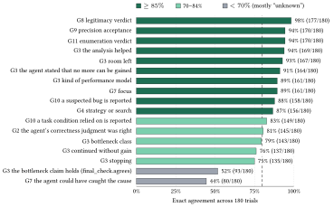

# Analyzer Cross-Check: Claude against Codex

Most labels on this site come from one LLM judge: Claude analyzes all 840 sessions, with Opus 5.5 as the analyst and Fable 5.2 on Opus 5.5's own sessions so that no model judges itself. To check how much the labels depend on that judge, a second vendor's model, Codex, analyzed 180 of the sessions again with the same inputs and goals, and we compare the two answers field by field. In effect, this section grades the Analyzer against a second Analyzer.

## Claude Against Codex Agreement Across 180 Traces

To check whether our Analyzer's behavioral labels depend on a single judge model, we analyzed all 180 sessions of the six Claude models twice using the same preprocessed trace package (`steps.v3`), the same rubric (11 goals, 17 fixed categorical fields), and the same prompt:

- **Claude analyst:** Opus 5.5 on 150 trials and Fable 5.2 on Opus 5.5's 30 trials to avoid self-evaluation.
- **Codex analyst:** GPT-6.1 Sol at `ultra` reasoning effort on all 180 trials.

**How we compare:** the comparison itself is a deterministic script, not an LLM. For each of the 17 fixed categorical fields, it normalizes both answers to the field's label set (for example, an answer `yes` followed by a short justification becomes `yes`) and counts the trials in which the two labels are identical. Only the labels being compared come from the two LLM analysts; the agreement rates are computed. For the nine free-form list fields, the script compares only the number of entries, not their content, and it does not judge which analyst is right where they differ.

Figure 1 reports exact label agreement across all 17 fixed rubric fields.

<figure class="njs-fig njs-wide" markdown="span">
  
  <figcaption><strong>Figure 1.</strong> Exact categorical agreement between Claude and Codex analysts across 180 trials and 17 rubric fields. The dashed line marks 80% agreement. Ten of 17 fields agree at 87% to 98%, and 12 of 17 agree at 80% or above.</figcaption>
</figure>

**Results:** Every behavioral label used in our core claims shows high cross-vendor agreement: G8 legitimacy verdict at 98%, G9 precision acceptance at 94%, G11 parameter-search verdict at 94%, G3 performance-model kind at 89%, G10 suspected bug reported at 88%, and G4 strategy against search pattern at 87%.

The two fields below 55% reflect a difference in willingness to decide rather than opposite verdicts. On G3 `final_check.agrees` (52%), 67 of the 87 differences are Codex answering `unknown` where Claude answers `yes` or `no`; direct `yes` against `no` contradictions occur in 16 of 180 trials (8.9%). On G7 `catchable_by_agent` (44%), 74 of the 100 differences are Codex answering `unknown`. On G3 stopping (75%), 37 of 45 disagreements lie on the boundary between `no-reason` and `continued-without-gain`; both analysts agree that justified stops are rare.

Table 1 compares mean counts on the nine free-form list fields across the same 180 trials.

| List field | Claude mean | Codex mean | Exact count match (of 180) |
| :--- | :---: | :---: | :---: |
| G1 optimization techniques | 22.9 | 18.0 | 8 |
| G5 errors encountered | 17.5 | 20.5 | 26 |
| G5 dead ends | 1.8 | 2.5 | 74 |
| G6 strengths | 5.4 | 5.0 | 74 |
| G6 weaknesses | 4.6 | 4.8 | 65 |
| G6 further optimization | 4.5 | 4.4 | 66 |
| G10 suspected bugs | 0.18 | 0.24 | 155 |
| G10 task conditions relied on | 1.8 | 1.3 | 80 |
| G11 parameter enumerations | 18.7 | 42.6 | 33 |

*Table 1. Mean list lengths reported per trial by Claude and Codex across 180 sessions.*

Codex enumerates more than twice as many individual parameter sweeps per trial (42.6 against 18.7) while matching Claude's G11 categorical verdict in 94% of trials.
