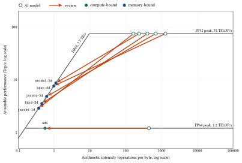
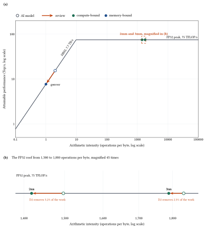

# Roofline Model

Every attainment number on this site compares a solution's performance with what the hardware allows for the reference algorithm. This page gives that roofline model for all 30 kernels: the operations and bytes of each kernel, where it sits on the B300 roofline, and how the model was built and reviewed.

## Definition

For each kernel, the model counts the arithmetic operations (Ops) of the reference algorithm and the bytes it must move between HBM and the GPU at the scored instance. Their ratio is the kernel's arithmetic intensity, $I = \text{Ops}/\text{Bytes}$. The roofline gives the highest performance the GPU can reach at that intensity:

$$
P_{\text{attainable}} = \min\left(\text{peak Op/s},\ I \times \text{peak HBM bandwidth}\right).
$$

A kernel left of the ridge point, where the two limits meet, is memory-bound; to its right, compute-bound. The attainment of a solution is its performance, counted with the reference algorithm's operations, over the attainable performance:

$$
\text{attainment} = \frac{\text{Ops} / T_{\text{measured}}}{P_{\text{attainable}}}.
$$

The peaks are those of an NVIDIA B300 GPU: 75 TFLOP/s for FP32 on CUDA cores, 1.2 TFLOP/s for FP64 (`adi`), 37.5 Top/s for INT32 (`floyd-warshall` and `nussinov`), and 7.7 TB/s of HBM bandwidth. Every scored instance is about 1 GB, eight times the GPU's L2 cache, so data cannot stay on chip. A solution can exceed 100% only by using hardware the model does not count, such as tensor cores, by moving less data than the reference algorithm, such as through temporal blocking, or by changing the algorithm ([Analysis 1](posts/01-breaking-the-roofline.md), [Analysis 2](posts/02-algorithms-vs-hacking.md)).

## How the Model Was Built and Reviewed

Building a performance model requires domain expertise, so we use cross-agent adversarial review: Fable 5.0 in Claude Code and GPT-6 Astra in Codex review each other's model until both agree. Three researchers checked ten kernels each and marked 13 potential issues. A final review consolidated those findings into two rules, D1 and D2, which revise 9 of the 30 kernels:

- **D1, stencil traffic per step:** The AI model counted each array once per run, assuming arrays fit on chip across time steps. At the scored sizes, arrays spill to HBM on every step. D1 is the only change that alters a kernel's bottleneck, turning the five iterative stencils memory-bound and shifting the bound by 1.7× to 26× across the six iterative time-step kernels.
- **D2, minimum exact operations:** The AI model counted operations from the reference C code as written. Under D2, we count the minimum exact operations needed at the scored instance. For `3mm` ($G = (AB)(CD)$ with rectangular scored dimensions), $A(B(CD))$ needs 1.381 TFLOP instead of 1.416 TFLOP for $(AB)(CD)$, 2.5% fewer. D2 also adjusts `2mm` (at most 5.5%), `gemver`, `adi`, and `heat-3d`, without altering any kernel's bottleneck.

Of the 24 kernels without time steps, 21 keep the AI performance model unchanged and three shift by at most 5.5%, so for these kernels the AI model aligns with our understanding.

## What the Review Changed

The review changes 9 of the 30 kernels. Figures 1 and 2 show on the roofline how each revision moves a kernel, the six time-step stencils and the three other revised kernels separately, with a magnified panel for the smallest changes; Table 1 gives the formulas before and after, in the notation of the paper.

<figure class="njs-fig njs-wide" markdown="span">
  
  <figcaption><strong>Figure 1.</strong> The six time-step stencils on the B300 roofline. Each arrow leads from the AI model (open circle) to the reviewed model (filled circle). D1 moves the five explicit stencils from the FP32 roof down onto the HBM slope; <code>adi</code> stays on the FP64 roof.</figcaption>
</figure>

<figure class="njs-fig njs-wide" markdown="span">
  
  <figcaption><strong>Figure 2.</strong> The three other kernels the review changes, on the B300 roofline; the 21 kernels it keeps are not drawn. (a) <code>gemver</code> moves down the HBM slope because D2 halves its operation count while its bytes stay the same. (b) The FP32 roof from 1,380 to 1,880 operations per byte, magnified 45 times, where the arrows of <code>2mm</code> and <code>3mm</code> become visible; D2 removes 5.2% and 2.5% of their work, and neither leaves the FP32 roof.</figcaption>
</figure>

--8<-- "includes/roofline-revisions.md"

*Table 1. The nine revisions. D1 counts stencil traffic on every time step; D2 counts the minimum exact operations. $T$ is the number of time steps, and Bytes include the element size (4 B for FP32, 8 B for FP64).*

D1 multiplies the traffic of the five explicit stencils by the number of time steps. Their intensity falls from hundreds or thousands of operations per byte to about one, which moves them from the flat FP32 roof down onto the HBM slope: they become memory-bound, and their attainable performance drops from 75 TFLOP/s to 3 to 9 TFLOP/s. On `adi`, D1 also lowers the intensity, but the FP64 roof is so low that the kernel stays compute-bound; D2 lowers its operation count, so it needs less time at the same 1.2 TFLOP/s. On `2mm` and `3mm`, D2 picks the cheapest evaluation order, which changes neither the roof nor the binding resource but removes 5% and 2.5% of the work. On `gemver`, D2 halves the operation count; the kernel stays memory-bound with the same bytes, so its minimum time does not change.

## Per-Kernel Model

--8<-- "includes/roofline-table.md"

*Table 2. The model of each kernel at its scored instance, with the nine revised kernels marked ✱. Ops and Bytes are formulas of the scored dimensions, Bytes including the element size (4 B for FP32 and INT32, 8 B for FP64); intensity and attainable performance follow from them as defined above. The per-kernel values are in `data/roofline.csv`.*
