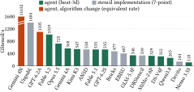

# Comparison Against Hand-Built Stencil Implementations

Because `heat-3d` reads the same seven neighbors as a 3-D 7-point star stencil, we measured AN5D, Bricks, EBISU, DRStencil, Devito, and an unpublished multi-step implementation built with Claude Code and Fable 5.0 in FP32 on B300 GPUs. Figure 1 compares their throughput against each vendor's fastest standard stencil agent solution plus Opus 5.5, Fable 5.1, and the two algorithm-changing solutions.

<figure class="njs-fig njs-wide" markdown="span">
  
  <figcaption><strong>Figure 1.</strong> Throughput of agent <code>heat-3d</code> solutions against hand-built 3-D 7-point stencil implementations in FP32 on NVIDIA B300 GPUs. Unpubl. marks our unpublished system built with Claude Code and Fable 5.0. Orange bars use a spectral closed form without time stepping, plotted at the equivalent update rate.</figcaption>
</figure>

**Results:** Among standard time-stepping implementations, Fable 5.2 is 2.5× as fast as EBISU and 1.9× to 7.1× as fast as AN5D, Bricks, DRStencil, and Devito. It reaches 73% of our unpublished implementation and is 1.9× as fast as Fable 5.1. Gemini 4 Neon and GPT-6.2 Astra reach 22× and 2.1× the speed of AN5D by removing the time steps. However, removing time steps omits intermediate states required by reverse time migration, full-waveform inversion checkpoints, and simulations that record intermediate steps for analysis.

The two algorithm-changing solutions are described in [Analysis 2](posts/02-algorithms-vs-hacking.md). The code of [Fable 5.2](code/heat-3d-fable-5-2.md), the fastest time-stepping solution, and of [Gemini 4 Neon](code/heat-3d-gemini-4-neon.md), the fastest algorithm change, is published with the reference kernel.
